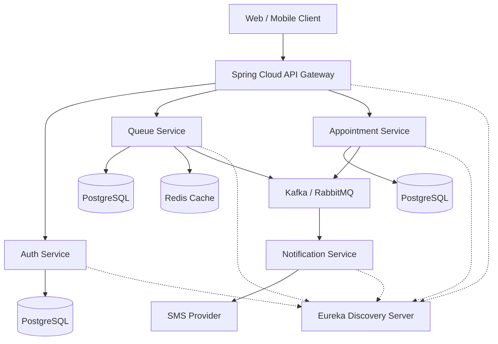

# QueueSphere
### Bangla-First Multi-Tenant Digital Queue & Appointment Management Platform

<p align="center">
  <strong>Smarter Queues. Better Services. Less Waiting.</strong>
</p>

<p align="center">
  
  
  
  
  
  
  
</p>

---

## Overview

**QueueSphere** is a Bangla-first, multi-tenant digital queue and appointment management platform designed to modernize how public and private organizations handle customer service operations.

In Bangladesh, people frequently spend hours waiting in queues at hospitals, banks, government offices, and other service centers. QueueSphere aims to reduce unnecessary waiting through digital token generation, real-time queue tracking, intelligent wait-time estimation, and automated notifications.

Built using a **Spring Boot Microservices Architecture**, the platform enables multiple organizations to manage their independent queues and appointments through a shared SaaS infrastructure while maintaining strict tenant-level data isolation.

## Key Features

### 🏢 Multi-Tenant Architecture
- Multiple organizations operate on a shared platform.
- Organization-level data isolation.
- Independent service counters and queue configurations.
- Role-based access control for administrators, staff, and customers.

### 🎫 Digital Queue Management
- Generate unique digital queue tokens.
- Real-time queue position tracking.
- Call, skip, and complete tokens.
- Concurrent token generation with database-safe operations.

### 📅 Appointment Management
- Schedule appointments in advance.
- Manage available time slots.
- Prevent duplicate booking and scheduling conflicts.
- Track appointment status.

### 🧠 Smart Waiting-Time Estimation
- Estimate waiting time using historical service durations.
- Moving average and weighted average calculation.
- Dynamically update estimated waiting times.
- Improve prediction accuracy as more service data becomes available.

### ⚡ Priority-Based Queue Scheduling
- Support priority handling for senior citizens.
- Emergency service prioritization.
- Priority support for pregnant women.
- Configurable priority rules for individual organizations.

### 🔔 Notification System
- SMS notifications for token updates.
- Automated notifications when a token is called.
- Appointment reminders.
- Event-driven communication between services.

### 🇧🇩 Bangla-First Experience
- Bangla and English user interface support.
- Localized date and time formatting.
- Mobile-friendly token tracking.
- Designed around Bangladesh's public service environment.

---

## System Architecture

QueueSphere follows a distributed microservices architecture where each service handles a specific business responsibility.



### Microservices

| Service | Responsibility |
|---|---|
| API Gateway | Centralized routing and request handling |
| Auth Service | Authentication, JWT and authorization |
| Queue Service | Token generation and live queue management |
| Appointment Service | Appointment booking and scheduling |
| Notification Service | SMS and event-based notifications |
| Eureka Server | Service discovery |

---

## Technology Stack

| Category | Technologies |
|---|---|
| Language | Java |
| Backend | Spring Boot, Spring MVC |
| Microservices | Spring Cloud, Eureka |
| API Gateway | Spring Cloud Gateway |
| Security | Spring Security, JWT |
| ORM | Hibernate, Spring Data JPA |
| Database | PostgreSQL |
| Cache | Redis |
| Messaging | Apache Kafka / RabbitMQ |
| Migration | Flyway |
| Testing | JUnit 5, Mockito, Testcontainers |
| API Documentation | Swagger, OpenAPI |
| Build Tool | Maven |
| Containerization | Docker, Docker Compose |
| Version Control | Git, GitHub |

---

## Project Structure

```text
QueueSphere/
│
├── api-gateway/
├── discovery-server/
├── auth-service/
├── queue-service/
├── appointment-service/
├── notification-service/
├── shared-libraries/
│
├── infrastructure/
│   ├── docker/
│   ├── postgres/
│   └── redis/
│
├── docs/
│   ├── architecture/
│   ├── api/
│   └── database/
│
├── docker-compose.yml
├── pom.xml
└── README.md
```

---

## Core Functional Workflow

### 1. Token Generation
A customer selects an organization, service category, and service counter. QueueSphere generates a unique queue token.

### 2. Queue Processing
The queue service manages token ordering, priority rules, and concurrent requests.

### 3. Live Queue Tracking
Customers can monitor their current queue position and estimated waiting time.

### 4. Token Calling
When staff call the next eligible token, the queue service publishes an event to the message broker.

### 5. Notification Delivery
The notification service consumes the event and sends an SMS notification to the customer.

---

## API Overview

The following endpoints represent the planned API structure.

| Method | Endpoint | Description |
|---|---|---|
| POST | `/api/v1/auth/register` | Register an organization |
| POST | `/api/v1/auth/login` | Authenticate a user |
| POST | `/api/v1/queues/tokens` | Generate a queue token |
| GET | `/api/v1/queues/{id}` | Get queue information |
| GET | `/api/v1/queues/{id}/status` | Track queue status |
| POST | `/api/v1/queues/{id}/call-next` | Call next eligible token |
| POST | `/api/v1/appointments` | Create appointment |
| GET | `/api/v1/appointments/{id}` | Get appointment details |

> **Note:** These are planned API contracts and may change during implementation.

---

## Getting Started

### Prerequisites

- Java 17 or later
- Maven 3.9+
- Docker and Docker Compose
- PostgreSQL
- Redis

### Clone Repository

```bash
git clone https://github.com/Saikot313/QueueSphere.git

cd QueueSphere
```

### Start Infrastructure

```bash
docker compose up -d
```

### Build the Project

```bash
mvn clean install
```

### Run Individual Services

```bash
cd discovery-server
mvn spring-boot:run
```

Start the remaining services using their respective directories and configurations.

> **Note:** Setup commands describe the intended workflow. Actual startup configuration will be documented as implementation progresses.

---

## Engineering Challenges & Solutions

| Challenge | Proposed Solution |
|---|---|
| Concurrent token generation | Database transactions and locking |
| Tenant data isolation | Tenant-aware authorization and query filtering |
| High-frequency queue updates | Redis-based live state management |
| Asynchronous notifications | Kafka / RabbitMQ event processing |
| Service failures | Timeouts, retries and circuit breakers |
| Database schema evolution | Flyway migrations |
| API security | JWT and Spring Security |
| Queue fairness | Configurable priority scheduling |

---

## Testing Strategy

QueueSphere aims to maintain reliability through multiple testing levels.

- **Unit Testing:** JUnit 5 and Mockito.
- **Integration Testing:** Spring Boot Test.
- **Database Testing:** Testcontainers with PostgreSQL.
- **API Testing:** Swagger and REST API testing.
- **Concurrency Testing:** Simultaneous token generation and queue operations.

---

## Roadmap

- [ ] Design database schemas and tenant isolation strategy.
- [ ] Implement authentication and authorization.
- [ ] Build Eureka Discovery Server.
- [ ] Implement API Gateway.
- [ ] Develop Queue Management Service.
- [ ] Implement concurrent token generation.
- [ ] Develop Appointment Service.
- [ ] Integrate Redis for live queue state.
- [ ] Integrate Kafka / RabbitMQ.
- [ ] Develop Notification Service.
- [ ] Implement smart waiting-time estimation.
- [ ] Add Bangla and English localization.
- [ ] Add automated unit and integration tests.
- [ ] Containerize all microservices.
- [ ] Implement CI/CD pipeline.
- [ ] Deploy a working demonstration.

---

## Future Enhancements

- AI-powered demand forecasting.
- Advanced queue analytics and reporting.
- Organization-specific service performance dashboards.
- WhatsApp and push notification integration.
- Kubernetes-based deployment and scaling.
- Mobile applications for customers and service providers.

---

## Why QueueSphere?

QueueSphere is designed to demonstrate practical backend engineering concepts through a real-world problem.

The project focuses on:

- Distributed system design.
- Microservices communication.
- Multi-tenant SaaS architecture.
- Database concurrency and transaction management.
- Event-driven architecture.
- Secure REST API development.
- Automated testing and containerization.

---

## Author

**Md. Sakender Saikot**

Computer Science & Engineering | Backend & Software Engineering

- GitHub: [@Saikot313](https://github.com/Saikot313)

---

## License

This project is licensed under the MIT License. See the `LICENSE` file for details.

<p align="center">
  <strong>QueueSphere</strong><br/>
  Making everyday service queues smarter, faster, and more accessible.
</p>
